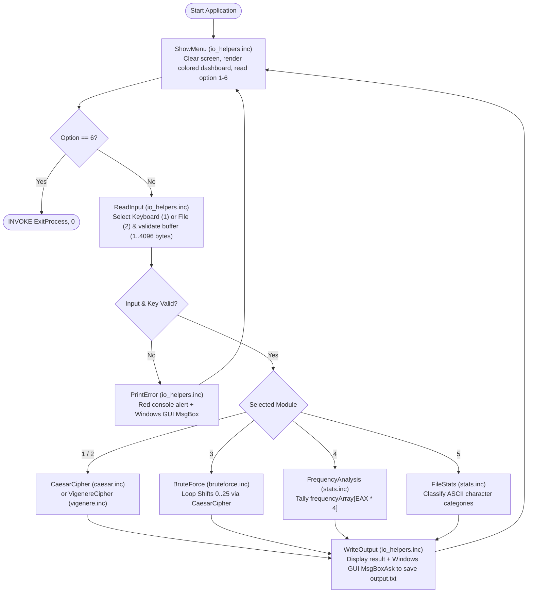

<div align="center">

# 🔐 x86 Assembly Cryptography & Cryptanalysis Tool (MASM / Irvine32)

**A Modular 32-Bit x86 Assembly File Encryption, Decryption, Caesar Brute-Force & Frequency Analysis Engine for Windows (Visual Studio 2022 + MASM + Irvine32)**

[-0F3773?style=for-the-badge&logo=intel&logoColor=white)](https://learn.microsoft.com/en-us/cpp/assembler/masm/)
[](http://asmirvine.com/)
[](https://visualstudio.microsoft.com/)
[-0078D6?style=for-the-badge&logo=windows&logoColor=white)](#)
[](LICENSE)

[**Explore Features**](#-features--capabilities) • [**System Architecture**](#-modular-system-architecture) • [**Visual Studio 2022 Setup**](#️-how-to-run-in-visual-studio-2022-masm--irvine32) • [**Testing Cheat Sheet**](#-quick-testing-guide) • [**COAL Concepts**](#-x86-assembly--coal-concepts-demonstrated)

</div>

---

## 📖 Overview

**x86 Assembly Cryptography Tool** is a complete, modular console and Windows-dialog application written in **32-bit x86 Assembly Language** using the **Microsoft Macro Assembler (MASM)** and **Kip Irvine's Irvine32 Library**.

Designed as a reference implementation for **Computer Organization and Assembly Language (COAL)** students and low-level systems programmers, this project demonstrates how classical symmetric ciphers, automated cryptanalysis attacks, text-statistics engines, and Win32 file I/O operate directly at the register and byte level without high-level C/C++ runtime dependencies.

Unlike monolithic single-file Assembly scripts, this project uses a clean **multi-file modular architecture (`.asm` + `.inc` header modules)**, a **color-coded console dashboard** (`SetTextColor`, `Clrscr`), and **native Windows GUI dialog prompts** (`MsgBoxAsk`, `MsgBox`).

---

## ✨ Features & Capabilities

### 1. 🔒 Caesar Cipher (Encryption & Decryption)
- **Mathematical Model:**
  - Encryption: $C = (P + K) \bmod 26$
  - Decryption: $P = (C - K + 26) \bmod 26$
- **Division-Free Modulo Arithmetic:** Uses fast register comparisons (`CMP AL, 26` / `SUB AL, 26`) instead of slow hardware `DIV` instructions.
- **Case & Symbol Preservation:** Shifts uppercase (`A–Z`) and lowercase (`a–z`) letters independently while leaving digits (`0–9`), spaces, and punctuation (`!@#$%^&*`) intact.
- **Key Validation:** Strictly enforces numeric shift keys in the range `1–25`.

### 2. 🔑 Vigenère Cipher (Polyalphabetic Substitution)
- **Repeating Keyword Engine:** Encrypts and decrypts text using an alphabetic keyword of up to 128 characters.
- **Automatic Key Normalization (`NormalizeKey`):** Validates that the keyword contains only English alphabetic characters and normalizes lowercase characters to uppercase using ASCII bit/arithmetic manipulation (`SUB AL, 32`).
- **Smart Index Advancement:** Uses dual index registers (`ESI` for plaintext/ciphertext, `EDI` for keyword) and advances `EDI` **only** on alphabetic characters so spaces and punctuation never desynchronize the keyword stream.

### 3. 🔓 Automated Caesar Brute-Force Cryptanalysis (All 26 Shifts)
- **Exhaustive Key Search:** Automatically iterates through all 26 possible shift keys (`Shift 0` to `Shift 25`) in a single loop by driving `CaesarCipher` with `modeFlag = 1`.
- **In-Memory Report Generation:** Simultaneously prints all 26 candidate plaintexts to the console and formats a complete 26-line cryptanalysis report in memory (`outputBuffer + 4100`) for one-click file export.

### 4. 📊 Case-Insensitive Letter Frequency Analysis (`A–Z`)
- **26-Element `DWORD` Counter Array:** Tallies occurrences of every English letter from `A` to `Z` (merging `A–Z` and `a–z` counts).
- **Scaled Indexed Addressing:** Demonstrates x86 scaled indexing (`INC frequencyArray[EAX * 4]`) to address 4-byte `DWORD` array elements in memory.

### 5. 📈 Comprehensive Character & File Statistics
- Categorizes every byte of input into five mutually exclusive buckets whose sum strictly equals **Total Characters**:
  1. **Total Characters** (`textLength`)
  2. **Uppercase Letters** (`ASCII 65–90`)
  3. **Lowercase Letters** (`ASCII 97–122`)
  4. **Numeric Digits** (`ASCII 48–57`)
  5. **Spaces** (`ASCII 32`)
  6. **Special Characters** (Punctuation, Tabs `ASCII 9`, and File Line Endings `CR/LF`)

### 6. 🖥️ Hybrid UI (Colored Console Dashboard + Native Windows GUI Dialogs)
- **Colored TUI Dashboard:** Uses Irvine32 `Clrscr`, `SetTextColor`, and `WaitMsg` for a clean royal-blue banner, cyan menu cards, yellow prompts, green results, and red error alerts.
- **Native Win32 Message Boxes:** Integrates `MsgBoxAsk` (interactive **Yes / No** Windows GUI dialog to save results to `output.txt`) and `MsgBox` (confirmation and error alert popups).

### 7. 📁 Dual Input & Fault-Tolerant File I/O
- Every module supports **1. Live Keyboard Input** (`ReadString`) and **2. External Text File Input** (`OpenInputFile`, `ReadFromFile`, `CloseFile`).
- **4-Layer File Validation:** Automatically detects and alerts on:
  - Missing or inaccessible files (`INVALID_HANDLE_VALUE`)
  - File read errors (`Carry Flag = 1`)
  - Empty files (`0` bytes)
  - Oversized files (`> 4096` bytes, detected via a `MAX_TEXT + 1` = `4097`-byte read guard)

---

## 🏗️ Modular System Architecture

The codebase is organized into six focused files (`661` lines total) linked via MASM's `INCLUDE` directive:

```text
x86-assembly-cryptography-tool/
│
├── main.asm                  # Data segment (.data), UI color constants, and main PROC menu dispatcher
├── io_helpers.inc            # ShowMenu, PrintError, ReadInput, WriteOutput ([EBP+8]/[EBP+12]), AppendDec, AppendStr
├── caesar.inc                # CaesarCipher (unified encryption & decryption procedure)
├── vigenere.inc              # NormalizeKey and VigenereCipher (polyalphabetic cipher module)
├── bruteforce.inc            # BruteForce (automated 26-shift Caesar cryptanalysis loop)
├── stats.inc                 # FrequencyAnalysis (A-Z array counters) and FileStats (ASCII classifier)
│
├── input.txt                 # Sample plaintext file for testing File Input mode
├── quick_test_cheatsheet.jpg # Visual 2-minute test cases cheat sheet
└── README.md                 # Documentation and setup guide
```



---

## 🛠️ How to Run in Visual Studio 2022 (MASM + Irvine32)

### Prerequisites
1. **Windows 10 / 11** with **Visual Studio 2022** (*Desktop development with C++* workload installed).
2. **Irvine32 Library** extracted at `C:\Irvine` (or `C:\Irvine\irvine`), containing `Irvine32.inc`, `Irvine32.lib`, `SmallWin.inc`, and `VirtualKeys.inc`.

### Step-by-Step Configuration
1. **Create Project:** Open Visual Studio 2022 $\rightarrow$ **Create a new project** $\rightarrow$ **Empty Project (C++)**.
2. **Set 32-Bit Target:** In the top toolbar, set Configuration to **`Debug`** and Platform to **`x86`** (`Win32`).
3. **Enable MASM:** In **Solution Explorer**, right-click the project name $\rightarrow$ **Build Dependencies** $\rightarrow$ **Build Customizations...** $\rightarrow$ check **`masm (.targets, .props)`** $\rightarrow$ click **OK**.
4. **Add Source Files:**
   - Copy `main.asm`, `io_helpers.inc`, `caesar.inc`, `vigenere.inc`, `bruteforce.inc`, `stats.inc`, and `input.txt` into your Visual Studio project folder.
   - Right-click **Source Files** $\rightarrow$ **Add** $\rightarrow$ **Existing Item...** $\rightarrow$ select **`main.asm` ONLY** *(do not add the `.inc` files to Solution Explorer's build list, as `main.asm` includes them automatically via `INCLUDE`)*.
5. **Configure Project Properties:** Right-click the project $\rightarrow$ **Properties**:
   - **Microsoft Macro Assembler $\rightarrow$ General $\rightarrow$ Include Paths:** `C:\Irvine` *(or `C:\Irvine\irvine`)*
   - **Linker $\rightarrow$ General $\rightarrow$ Additional Library Directories:** `C:\Irvine` *(or `C:\Irvine\irvine`)*
   - **Linker $\rightarrow$ Input $\rightarrow$ Additional Dependencies:** `Irvine32.lib;%(AdditionalDependencies)`
   - **Linker $\rightarrow$ System $\rightarrow$ SubSystem:** `Console (/SUBSYSTEM:CONSOLE)`
6. **Build & Run:** Press **`Ctrl + F5`** (*Start Without Debugging*).

---

## 🧪 Quick Testing Guide


| Test Case | Menu Path | Sample Input | Key / Keyword | Expected Output |
| :--- | :--- | :--- | :--- | :--- |
| **Caesar Encrypt** | `1` $\rightarrow$ `1` $\rightarrow$ `1` | `HELLO WORLD 123!` | `3` | `KHOOR ZRUOG 123!` |
| **Caesar Decrypt** | `2` $\rightarrow$ `1` $\rightarrow$ `2` | File: `output.txt` | `3` | `HELLO WORLD 123!` |
| **Caesar Wrap-Around** | `1` $\rightarrow$ `1` $\rightarrow$ `1` | `XYZ xyz` | `3` | `ABC abc` |
| **Vigenère Encrypt** | `1` $\rightarrow$ `2` $\rightarrow$ `1` | `ATTACKATDAWN` | `lemon` | `LXFOPVEFRNHR` |
| **Vigenère Decrypt** | `2` $\rightarrow$ `2` $\rightarrow$ `1` | `LXFOPVEFRNHR` | `LEMON` | `ATTACKATDAWN` |
| **Caesar Brute Force** | `3` $\rightarrow$ `1` | `KHOOR` | *(None)* | `Shift 0` .. `Shift 25` (`Shift 3 : HELLO`) |
| **Frequency Analysis** | `4` $\rightarrow$ `1` | `AABb!` | *(None)* | `A : 2`, `B : 2`, `C : 0` .. `Z : 0` |
| **Character Statistics** | `5` $\rightarrow$ `1` | `Hi 1!` | *(None)* | Total: `5`, Upper: `1`, Lower: `1`, Digit: `1`, Space: `1`, Special: `1` |

---

## 🧠 x86 Assembly & COAL Concepts Demonstrated

- **Register Allocation & Preservation:** Disciplined use of `EAX/AL`, `EBX/BL`, `ECX`, `EDX`, `ESI`, `EDI`, `EBP`, and `ESP` with balanced `PUSH`/`POP` pairs in every procedure.
- **Stack Frames & Stdcall Cleanup:** `WriteOutput` constructs an explicit stack frame (`PUSH EBP` / `MOV EBP, ESP`), reads parameters from `[EBP + 8]` (buffer offset) and `[EBP + 12]` (byte length), and cleans up 8 bytes of caller arguments via `RET 8`.
- **Scaled Indexed Addressing:** Accessing 32-bit `DWORD` counters in `frequencyArray` using `frequencyArray[EAX * 4]`.
- **Stack-Based Integer-to-ASCII Conversion (`AppendDec`):** Repeated division by 10 (`DIV EBX`), converting remainders in `DL` to ASCII (`ADD DL, '0'`), pushing digits onto the hardware stack, and popping them into `[EDI]` in left-to-right decimal order.
- **Win32 API File & Dialog Wrappers:** `OpenInputFile`, `ReadFromFile`, `CreateOutputFile`, `WriteToFile`, `CloseFile`, `MsgBox`, and `MsgBoxAsk`.

---

## 👥 Authors & Academic Credits

- **Muhammad Ayan** (`P250600`) — *Group Leader (Cipher Implementation, System Architecture & Integration)*
- **Partham Kumar** (`K250626`) — *Group Member (File I/O, Cryptanalysis, Statistical Modules & Validation)*
- **Course:** EL-2003 Computer Organization and Assembly Language (COAL) Lab — *Section BCS-3C, Group G1*
- **Instructor:** Mr. Muhammad Owais
- **Institution:** National University of Computer and Emerging Sciences (**FAST-NUCES**), Karachi Campus

---

## 🔍 Keywords & Topics

`x86-assembly` `masm` `irvine32` `assembly-language` `cryptography` `caesar-cipher` `vigenere-cipher` `brute-force` `frequency-analysis` `cryptanalysis` `visual-studio-2022` `win32-assembly` `coal-project` `fast-nuces` `computer-organization`
